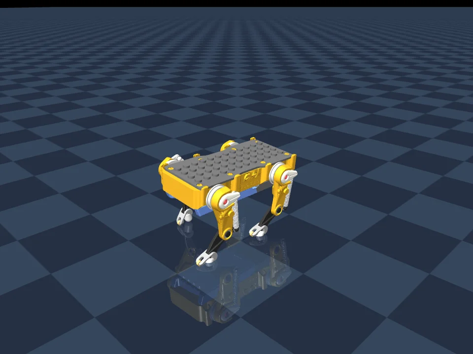

# Petoi Quaddle：四舵机 MuJoCo 步行仿真

import QuaddleSimulator from '@site/src/components/QuaddleSimulator';

这个实验使用 [Petoi 官方 Quaddle 模型](https://huggingface.co/petoi/quaddle)，补充 MuJoCo 的闭环约束、驱动器和接触配置，让四个舵机驱动机器人向前行走。控制器采用周期关节目标和方向反馈，没有使用强化学习或 Petoi 官方固件。

## 在线运行

<QuaddleSimulator />

点击“加载在线仿真”，再点击“行走”。起步会先稳定 2 秒，然后逐渐加大步幅。“停止并站立”保留重力和接触计算；“暂停物理”才会冻结整个世界。切换到其他标签页或滚动离开仿真区域时会自动挂起，返回后继续。

网页使用官方 MuJoCo 3.16.0 WebAssembly，在后台线程中运行同一份 MJCF 模型和步态参数；Three.js 根据物理引擎输出的几何体位置绘制画面。它不依赖 Python 服务，也不从视频读取动作。性能不足时仿真时间会比现实时间慢，界面显示的是仿真时间。[官方 JavaScript 绑定说明](https://github.com/google-deepmind/mujoco/blob/main/wasm/README.md)

### 录制演示

以下视频保留为运行效果参考；上方窗口可以实时控制。

<video controls playsInline preload="metadata" src={require('./figs/quaddle-walking.mp4').default} style={{width: '100%'}} />

源码位于仓库的 `codes/practices/quadruped/quaddle-mujoco/`。已在 Apple Silicon macOS、Python 3.12.13、MuJoCo 3.16.0 上验证。

## 安装和运行

在仓库根目录执行：

```bash
git lfs pull
cd codes/practices/quadruped/quaddle-mujoco
uv venv --python 3.12 .venv
uv pip sync --python .venv/bin/python requirements.lock
./run.command --mode walk
```

STL 网格由 Git LFS 管理，需先安装 Git LFS 并下载真实文件。场景和简化后的网格已经包含在工程中，不需要每次启动都重新转换模型。

macOS 启动器会调用 `mjpython`，并为当前进程设置 uv Python 所需的动态库查找路径。安装依赖后也可以直接双击 `run.command`。Linux 可在相同虚拟环境内执行 `python run_sim.py --mode walk`；本次没有验证 Linux 图形窗口。

| 按键 | 功能 |
| --- | --- |
| W | 开始步行 |
| S | 平滑停止并站立 |
| R | 重置机器人位置和仿真时间 |
| 空格 | 暂停或继续 |
| M | 轮换站立、小幅摆动、步行模式 |
| 鼠标拖动／滚轮 | 旋转视角或缩放 |

启动后先站立 2 秒，再用 1.5 秒逐渐启动步态。机身移动来自关节驱动和地面接触，控制器只修改四个舵机的位置目标。

## 走远后仍能看到棋盘地面



早期场景使用 `size="2 2 0.1"`，地面碰撞是无限的，但渲染只覆盖中心 4×4 米。机器人走远后，相机跟着移动，地面就从画面中消失。

现在使用 MuJoCo 的无限平面渲染，并让棋盘纹理按世界坐标重复：

```xml
<material name="floor" texture="grid"
          texuniform="true" texrepeat="16 16" reflectance="0.12" />
<geom name="ground" type="plane" size="0 0 0.1"
      material="floor" contype="1" conaffinity="2"
      friction="0.8 0.002 0.0001" />
```

前两个尺寸设为零会绘制无限平面，`texuniform` 则使纹理密度不依赖平面尺寸。这里没有改变碰撞、摩擦或步态参数。[MuJoCo 参数说明](https://mujoco.readthedocs.io/en/stable/XMLreference.html#body-geom-type)

`reports/floor_visibility.json` 保存连续行走 120 秒的显示检查，另有将渲染位置平移到千米量级的静态检查；后者只验证显示范围，不代表机器人实际走了千米。

## 当前步态和验证结果

四条腿使用四分之一周期错开的控制相位，左右腿相差半个周期；步频约 1.94 Hz，前后腿标称摆幅约 23° 和 28°。实际落脚时刻还受被动连杆、弹簧和脚轮接触影响，并不是理想的无滑移点足运动。

| 默认场景的检查 | 结果 |
| --- | --- |
| 连续步行 60 秒 | 前进约 4.57 m |
| 最大横向偏离 | 约 4.3 cm |
| 机身触地、数值警告、外加推动力 | 均为 0 |
| 停止检查 | 步行后切换站立，速度降至 0.001 m/s 以下 |
| 站立和小幅摆动 | 各运行 30 秒通过 |

在同一模型上与原先偏重前进距离的步态比较，机身高度标准差由约 1.67 mm 降至 0.66 mm，接触点平均切向速度由约 0.059 m/s 降至 0.047 m/s；前进速度也相应降低。旧步态配置保留在 `reference/previous-gait.json`，可重新运行对比。

```bash
# 默认地面的行走和停止验证
.venv/bin/python validate_walk.py --seconds 60

# 站立和小幅摆动
.venv/bin/python run_sim.py --validate --duration 30

# 重新生成步行视频
.venv/bin/python render_demo.py --seconds 14 --output quaddle-coordinated

# 用当前模型比较新旧步态
.venv/bin/python search_natural.py --compare
```

验证输出写入 `outputs/`；随工程附带的结果在 `reports/`。生成的缓存、视频和虚拟环境不直接进入代码版本管理，页面展示素材单独保存在本页的 `figs/` 中。

## 强化学习：从固定步态到残差 PPO

### 当前机器人是怎样学会走路的？

上方网页的动作来自 `gait.json` 和 `gait_controller.py`：先指定周期轨迹，再用仿真搜索摆幅、偏置、频率和反馈增益。搜索挑选的是一组参数；运行时执行这组参数，结合偏航和横向位置调整左右步幅。

这个过程没有神经网络、经验缓冲区、优势估计或梯度更新，所以不能把它称为“训练好的 PPO 策略”。强化学习需要增加状态—动作交互、回报计算和策略更新，才能根据当前状态学习不同的动作。

| 方法 | 优化的对象 | 运行时做什么 | 本项目状态 |
| --- | --- | --- | --- |
| 步态参数搜索 | 一组摆幅、频率、相位和反馈增益 | 按时间生成关节目标 | 网页正在使用 |
| 残差强化学习 | 从观测到动作的神经网络 | 根据机身状态修正基准步态 | 已提供环境、训练和评估脚本；完成短训练验证 |
| 从零学习步态 | 全部关节目标或力矩策略 | 直接决定每次动作 | 尚未实现 |

这里选择**残差 PPO**作为可复现实验。现有步态负责基本协调，策略只学习四个小修正量。零修正就能作为基线，因此可以测量策略究竟带来了改进，还是破坏了原来的稳定性。

> **实验状态：** 网页仍使用周期控制器。PPO 示例已完成环境检查、2,048 个 transition 的短训练，以及保存后重新加载的评估；这仅证明训练链路可运行，没有证明策略优于基线，也没有把短训练权重装入网页。

### 1. 环境、观测与动作

`rl_env.py` 中的 `QuaddleResidualEnv` 使用同一个 MuJoCo 模型，按 Gymnasium 的 `reset()` / `step(action)` 接口组织训练。环境中的“前方”是模型初始姿态的世界 **−Y**，横向是 **X**。不要照搬其他机器人沿 +X 行走的奖励公式。

- 物理步长：1 ms。
- 策略频率：100 Hz；每个动作保持 10 个物理步。
- 回合长度：20 秒策略交互，之前先用 2 秒建立静止接触。
- 目标速度：固定 0.075 m/s；当前示例训练直行，不是转向、变速或停止策略。
- 跌倒终止：机身接触地面、机身高度低于 0.025 m，或机身竖直轴与世界竖直轴的余弦小于 0.7。
- 时间到达 20 秒属于 `truncated`；跌倒属于 `terminated`。这会影响价值函数是否在回合边界继续估计后续回报。[Gymnasium 环境接口](https://gymnasium.farama.org/introduction/create_custom_env/)

观测向量共 **32 维**，顺序固定如下。线速度和角速度通过 MuJoCo 转到机身坐标系；比例因子用于让各量级更接近，训练时再使用 `VecNormalize`。

| 观测 | 维数 | 用途／缩放 |
| --- | --- | --- |
| 机身坐标系中的重力方向 | 3 | 判断倾斜，不包含绝对位置 |
| 机身线速度 | 3 | 除以 0.1 m/s |
| 机身角速度 | 3 | 除以 5 rad/s |
| 四个主动关节的位置 | 4 | 弧度，顺序为左前、右前、右后、左后 |
| 四个主动关节的速度 | 4 | 除以 10 rad/s |
| 上一次归一化残差动作 | 4 | 帮助保持动作连续 |
| 基准步态相位的 sin、cos | 2 | 表示周期，避免相位跳变 |
| 目标前进速度 | 1 | 除以 0.1 m/s |
| 当前基准关节目标 | 4 | 让策略知道它在修正什么 |
| 起步渐变进度 | 1 | 从 0 增至 1 |
| 相对起点的横向偏离 | 1 | 除以 0.1 m |
| 航向角的 sin、cos | 2 | 提供方向误差 |

这是一组面向控制的部分观测，没有包含所有被动关节状态。复杂接触、传感器延迟或更强扰动下，可以再考虑历史帧或循环策略。训练中读取的速度和姿态是仿真真值；实机需要对应的状态估计，不能默认可以无误差获得。

策略输出 $a_t\in[-1,1]^4$，转换为四个主动关节的目标：

$$
q_t^{\mathrm{desired}}=\operatorname{clip}\left(q_t^{\mathrm{reference}}+0.12a_t,-1.2,1.2\right).
$$

0.12 rad 约为 6.9°。发送前再限制目标变化率为 8 rad/s。随后 MuJoCo 的位置执行器生成受力矩限制的驱动力；网络不能修改浮动基座的位置，也不能直接驱动被动膝关节。此环境在 100 Hz 下保持动作，与原生查看器逐物理步计算过渡混合的方式略有差别，因此比较策略时使用**同一个 RL 环境里的零残差基线**。

### 2. 奖励怎样定义

只奖励“往前走得远”容易诱导蹬跳、滑行或大幅摆腿。这个示例优先跟踪适中速度，同时抑制横漂、机身抖动、过大力矩和动作突变。

每 10 ms 返回一次奖励：

$$
r_t=\Delta t\sum_k r_{t,k}-2\,\mathbf{1}_{\mathrm{fall}},\qquad \Delta t=0.01.
$$

连续奖励乘时间步长，避免仅改变控制频率就让每秒回报成倍变化。下面的系数是这个实验的起点，需要靠评估和消融调整，不是 Quaddle 的最优参数。

| 奖励项 | 脚本中的定义 | 作用 |
| --- | --- | --- |
| 速度跟踪 | $\exp(-((v_f-0.075)/0.05)^2)$ | 靠近目标速度得高分，过快也不加分 |
| 保持直立 | $0.3R_{zz}$ | 倾斜时减分 |
| 横向控制 | $-0.1(v_x/0.1)^2-0.05(\Delta x/0.1)^2$ | 同时限制侧向速度和累积偏离 |
| 上下抖动 | $-0.05(v_z/0.1)^2$ | 抑制弹跳 |
| 偏航速度 | $-0.02(\omega_z/2)^2$ | 抑制快速转动 |
| 力矩 | $-0.01\operatorname{mean}((\tau/0.245)^2)$ | 抑制过大的驱动力矩 |
| 动作突变 | $-0.02\operatorname{mean}((a_t-a_{t-1})^2)$ | 鼓励连续修正 |
| 修正幅度 | $-0.01\operatorname{mean}(a_t^2)$ | 没有收益时尽量保留基准步态 |

每次 `step()` 都在 `info["reward_terms"]` 中返回分项，排查时可以观察是哪一项主导了训练。不能只看总奖励曲线：策略可能通过站着不动、缩短回合或滑行来规避惩罚。尤其 Quaddle 有脚轮，轮心相对地面的速度不等于接触点滑移；当前奖励没有加入一个未经验证的“足端不动”约束。

### 3. PPO 在更新什么

Actor 网络输出四维高斯动作分布，训练时从分布采样残差；Critic 网络估计当前状态的后续回报。网络输入是上述观测，各自使用两层 64 单元的 MLP。MuJoCo 负责产生下一状态和奖励，梯度不会穿过物理引擎。

一次更新包括：收集多条轨迹 → 用价值估计计算优势 → 将轨迹打乱分批 → 更新策略和价值网络 → 重新采样。优势可以理解为“这次动作的结果，比当前价值网络原本预期的好多少”。

PPO 的策略目标使用新旧动作概率之比 $\rho_t$，限制一次更新的幅度：

$$
\begin{aligned}
\ell_t&=\min\left(\rho_t\hat A_t,\operatorname{clip}(\rho_t,1-\epsilon,1+\epsilon)\hat A_t\right),\\
L^{\mathrm{clip}}&=\mathbb{E}_t[\ell_t].
\end{aligned}
$$

实现使用 Stable-Baselines3，包含优势归一化、价值损失和熵项；仍需观察 KL、clip fraction、价值解释度和实际任务指标，裁剪不保证任意更新都安全。[PPO 论文](https://arxiv.org/abs/1707.06347)、[Stable-Baselines3 PPO 文档](https://stable-baselines3.readthedocs.io/en/stable/modules/ppo.html)

`train_ppo.py` 的正式配置是 4 个 CPU 环境，每个环境采集 1,024 步，共 4,096 个 transition 后更新；batch size 为 256，重复 10 个 epoch。学习率为 $3\times10^{-4}$，折扣因子为 0.995，GAE 参数为 0.95，clip 为 0.2。CPU 子进程负责并行采样，没有要求 NVIDIA GPU。

### 4. 安装、检查、训练和评估

以下命令在 `codes/practices/quadruped/quaddle-mujoco/` 中执行。训练使用独立环境，避免改动原来的仿真依赖。

```bash
uv venv --python 3.12 .venv-rl
uv pip sync --python .venv-rl/bin/python requirements-rl.lock

# Gymnasium/SB3 接口、种子复现、超时语义、零残差物理基线
.venv-rl/bin/python check_rl.py

# 先验证采样、梯度更新、保存与加载。此步不代表策略收敛。
.venv-rl/bin/python train_ppo.py --smoke --steps 2048 --envs 2 \
  --output outputs/ppo-smoke
.venv-rl/bin/python evaluate_ppo.py --model outputs/ppo-smoke --episodes 2

# 正式实验示例：从头训练；步数是实验预算，不是成功保证。
.venv-rl/bin/python train_ppo.py --steps 1000000 --envs 4 --seed 0 \
  --output outputs/ppo-seed0
.venv-rl/bin/python evaluate_ppo.py --model outputs/ppo-seed0 --episodes 10
.venv-rl/bin/python evaluate_ppo.py --model outputs/ppo-seed0 --episodes 10 --randomize
```

正式训练默认只使用名义地面。加 `--randomize` 会在每回合重置时随机化初始偏航（±0.03 rad）以及地面和脚轮的滑动摩擦（0.7–0.9）；它尚未覆盖质量、弹簧、延迟、地形或传感器噪声。可以先做名义场景基线，再比较加随机化后的结果。

训练目录包含：

| 文件 | 内容 |
| --- | --- |
| `policy.zip` | 最后一次更新的策略、价值网络和优化器状态 |
| `vecnormalize.pkl` | 同时保存的观测归一化统计量；部署和评估不能省略 |
| `metadata.json` | 随机种子、实际步数、模型与步态校验值、依赖版本和动作接口 |
| `evaluation/evaluations.npz` | 每 20,000 个 transition 的名义场景评估曲线（短训练可能尚未触发） |
| `evaluation-nominal.json` | 重新加载后与零残差基线的逐回合比较 |
| `evaluation-randomized.json` | 在随机初始状态和摩擦下的逐回合比较 |

训练脚本每次从头开始；保存了优化器不代表已经实现命令行续训。`outputs/` 中的权重和日志默认不进 Git。短训练检查结果保存在 `reports/rl_smoke.json`，它不是已收敛策略的性能报告。

### 5. 怎样判断策略真的更好

`evaluate_ppo.py` 对零残差和 PPO 使用相同的测试种子，以确定性动作比较回报、前进距离、最小直立余弦、最大横漂和跌倒情况。评估关闭观测统计更新，保持训练时的输入定义。

默认名义环境是确定性的，多跑相同回合不会产生独立证据。应至少比较多个训练种子，再用未参与训练的随机测试种子和扰动条件检验；成功率、速度误差、抖动、接触滑移和停止性能都需要分别记录。当前评估脚本只记录上述基础指标，完整的滑移与停止策略评估仍需扩展。不能用一次较高的 reward 宣称“更像狗”或“可上实机”。

### 6. 训练策略怎样接回网页

当前网页运行的是 `web/controller.mjs`。如果后续确认 PPO 策略有改进，可以导出确定性 Actor，连同观测均值、方差、动作缩放和模型校验值一起打包。网页后台线程按相同的 100 Hz 顺序读取 32 维观测、做归一化、推理残差，再执行 10 个物理步。先对比相同状态下 Python 和网页的动作，再做长时间闭环验证。

这一步尚未实现。网页按钮不会启动 Python 训练，也没有在后台偷偷更新网络；浏览器实时仿真、原生 PPO 训练、训练后策略部署是三个可以分别验证的环节。

## 模型边界

Quaddle 每条腿只有一个主动舵机，膝部使用被动连杆与弹簧，足端带滚动机构。当前适配保留官方外形和惯性，但用被动关节扭转弹簧近似支撑，没有标定实际弹簧伸缩、预紧、舵机延迟和摩擦。

当前步态适用于已验证的默认平地和初始状态。将所有碰撞几何体的滑动摩擦统一改为 0.6 或 1.0 时，额外检查出现偏航、姿态或横向偏离超限，未通过。默认场景运行成功不代表实机验证或跨地面稳健性。

官方源文件及 MIT 许可证保存在 `original/`，固定版本为 `d5ed8ccfd238f98c2c47eb47658ed23232b1a74d`。`source_manifest.json` 保存原始文件校验值；重建场景可运行 `.venv/bin/python build_model.py`。
